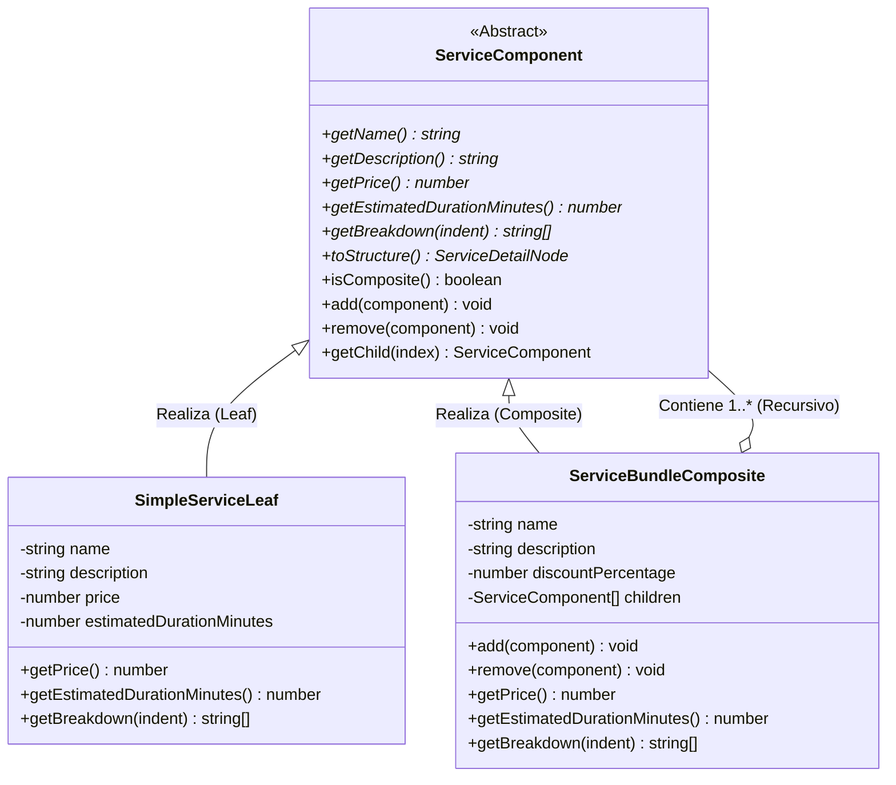
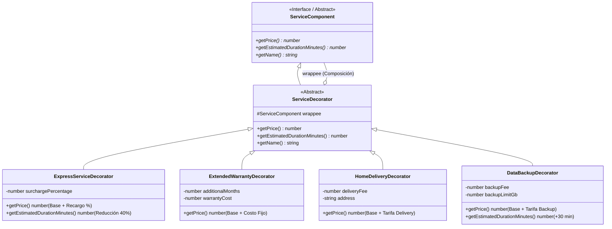

# 🏗️ Patrones de Diseño Estructurales: Composite y Decorator
## Proyecto: TecnoTaller / TecnoFix API

---

## 📌 1. Introducción y Justificación Arquitectónica

En el dominio de **TecnoTaller**, la gestión de servicios técnicos, reparaciones de dispositivos y presupuestos presenta dos retos estructurales fundamentales:

1. **Jerarquías Parte-Todo (¿Cómo tratar combos y servicios individuales de forma uniforme?):**
   Un cliente puede solicitar una reparación atómica (ej. *Cambio de Pasta Térmica*), o bien un paquete promocional o plan de mantenimiento que agrupa múltiples servicios (ej. *Combo Preventivo Completo*, o un *Plan Corporativo* compuesto por varios sub-combos). El sistema debe ser capaz de calcular subtotales, duraciones estimadas y desgloses jerárquicos sin que el cliente del código tenga que hacer distinciones complejas con `if/else`.
   👉 **Solución:** **Patrón Composite (Objeto Compuesto)**.

2. **Extensión Dinámica de Comportamiento sin Explosión Combinatoria:**
   Sobre cualquier servicio o paquete, el cliente puede solicitar modificaciones o modalidades adicionales:
   - Atención inmediata prioritaria (*Servicio Express ⚡* con recargo y menor tiempo de espera).
   - Extensión de la garantía de fábrica (*Garantía Extendida Premium 🛡️* con costo de póliza).
   - Logística de transporte (*Recogida y Entrega a Domicilio 🚚*).
   - Seguridad y salvaguarda (*Respaldo Preventivo de Información 💾*).
   Intentar resolver estas variantes con herencia pura provocaría una explosión de subclases inmanejable (ej. `ComboPreventivoExpressConGarantiaYDelivery`).
   👉 **Solución:** **Patrón Decorator (Decorador)**.

---

## 🧩 2. Patrón Composite (Estructura de Árbol)

### 2.1. Diagrama de Clases (Mermaid)



### 2.2. Componentes Clave:
* **`ServiceComponent`** ([`src/modules/services/service-composite.ts`](file:///c:/Users/JUAN%20ASSIA/Desktop/tecnotaller/tecnotaller-backend/src/modules/services/service-composite.ts)): Contrato base unificado para hojas simples y combos.
* **`SimpleServiceLeaf`**: Servicio atómico (ej: *Cambio de Pantalla*, *Batería*, *Limpieza*).
* **`ServiceBundleComposite`**: Agrupador jerárquico que suma recursivamente precios y tiempos de sus elementos hijos y aplica descuentos por paquete.

---

## 🎨 3. Patrón Decorator (Envoltura Dinámica)

### 3.1. Diagrama de Clases (Mermaid)



---

## ⚡ 4. Sinergia Total: Composite + Decorator

La mayor ventaja de esta arquitectura es que **ambos patrones comparten la misma interfaz (`ServiceComponent`)**. Esto posibilita escenarios avanzados:

1. **Hojas Decoradas dentro de un Composite:**
   Un paquete puede incluir un servicio regular junto a otro que lleva garantía extendida.
2. **Composite Completo Decorado:**
   Todo un paquete promocional o plan corporativo puede ser envuelto con un `ExpressServiceDecorator` para que toda la orden sea de atención prioritaria.
3. **Apilamiento Múltiple (Decorator Stacking):**
   ```typescript
   // Servicio base envuelto consecutivamente:
   const ordenFinal = new ExpressServiceDecorator(
     new HomeDeliveryDecorator(
       new ExtendedWarrantyDecorator(comboMantenimiento, 12, 25),
       15,
       'Calle 100 # 15-20'
     ),
     20
   );
   ```

---

## 🧪 5. Pruebas Unitarias Automatizadas

Las pruebas para ambos patrones y su interacción conjunta residen en:
* [`src/shared/structural-patterns.test.ts`](file:///c:/Users/JUAN%20ASSIA/Desktop/tecnotaller/tecnotaller-backend/src/shared/structural-patterns.test.ts)

Para ejecutarlas:
```bash
npx vitest run src/shared/structural-patterns.test.ts
```
Resultado: **16/16 pruebas pasando exitosamente (100%)**.
